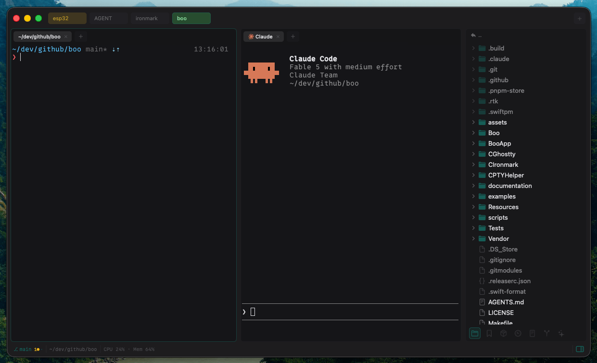
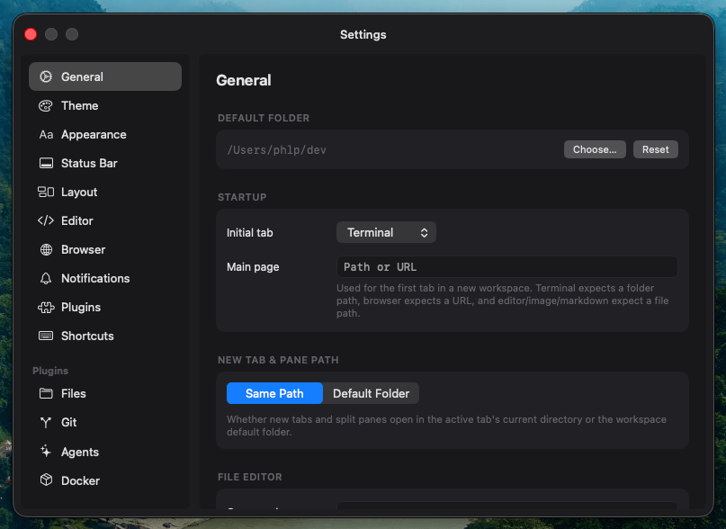

<p align="center"></p>

# Boo

A native macOS terminal with workspaces, split panes, a file explorer and agent tools. Built on [Ghostty](https://github.com/ghostty-org/ghostty) for terminal emulation and Metal rendering.

**Docs:** https://ph1p.github.io/boo/

## Screenshots

<p align="center">
  
  
</p>

## Install

Download the latest release from [GitHub Releases](https://github.com/ph1p/boo/releases), unzip it and move Boo to Applications. Requires macOS 15+ on Apple Silicon.

> **"Boo cannot be opened" (Gatekeeper)** — If macOS blocks the app after installing, run:
>
> ```bash
> xattr -dr com.apple.quarantine /Applications/Boo.app
> ```

Boo updates itself through Sparkle (**Boo → Check for Updates...**).

## Features

- **Workspaces, panes and tabs** — Folders as workspaces, splits in any direction, a tab bar per pane, tab groups, multiple windows, session and scrollback restore ([docs](https://ph1p.github.io/boo/windows-and-splits))
- **Tabs beyond the terminal** — Browser, code editor, image viewer and markdown preview ([docs](https://ph1p.github.io/boo/multi-content-tabs))
- **File explorer** — Live file tree with git status, for local folders and for SSH, Mosh, container, VM and device shells ([docs](https://ph1p.github.io/boo/remote-sessions))
- **Sidebar plugins** — Git, Docker, Kubernetes, SSH hosts, notes, snippets, bookmarks, system info; write your own in JavaScript ([docs](https://ph1p.github.io/boo/plugins))
- **Agents** — Inbox for Claude Code, Codex and OpenCode, worktree tasks, diff review, timeline and cost, an orchestrator and an MCP server ([docs](https://ph1p.github.io/boo/agents))
- **Terminal tools** — Command palette, quick terminal, quick select, copy mode, command blocks, broadcast input, session recording with MP4 export ([docs](https://ph1p.github.io/boo/features))
- **tmux** — `tmux -CC` sessions open as native workspaces and panes ([docs](https://ph1p.github.io/boo/features#tmux))
- **Themes** — 32 built-in themes, a theme editor, iTerm2 and Ghostty theme import ([docs](https://ph1p.github.io/boo/features#themes))
- **Profiles and rules** — Per-tab theme, font, shader, shell and environment by host, folder or process; rules that react to output ([docs](https://ph1p.github.io/boo/rules-and-profiles))
- **History and sync** — Search every command run in Boo; sync settings across Macs ([docs](https://ph1p.github.io/boo/history-and-sync))
- **Remote control** — Optional web UI to drive Boo from another device on your LAN ([docs](https://ph1p.github.io/boo/remote-control))
- **Scripting** — Unix socket at `~/.boo/boo.sock` for status, layout, agents and plugin commands ([docs](https://ph1p.github.io/boo/ipc-socket))
- **Security** — Secure Keyboard Entry, paste and clipboard-read confirmations, owner-only `~/.boo` ([docs](https://ph1p.github.io/boo/security))

All shortcuts are listed in the [docs](https://ph1p.github.io/boo/keyboard-shortcuts) and can be rebound in **Settings → Shortcuts**.

## Build from Source

Prerequisites:

- macOS 15+ and Xcode 26 / Swift 6.2 (or the matching Command Line Tools)
- Zig 0.17.0, the version pinned by `Vendor/ghostty/build.zig.zon` (`brew install zig`)
- Rust (`rustup`)
- Node.js + pnpm, for the bundled Monaco editor
- Metal Toolchain: `xcodebuild -downloadComponent MetalToolchain`

```bash
git clone --recursive https://github.com/ph1p/boo.git
cd boo
make setup    # Builds GhosttyKit, ironmark, Monaco and Boo
make run      # Build and launch
```

`make run` builds a debug app with Sparkle turned off.

macOS forgets privacy grants (Full Disk Access, folders, Automation) whenever an ad-hoc signature changes, which is every build. Run `scripts/create-signing-cert.sh` once: it adds a self-signed "Boo Self-Signed" identity to your keychain, and `make run` signs with it so grants survive rebuilds.

| Target                       | Description                                       |
| ---------------------------- | ------------------------------------------------- |
| `make build`                 | Debug build                                       |
| `make test`                  | Run the tests                                     |
| `make lint` / `make format`  | Check / fix code style with swift-format          |
| `make release` / `make app`  | Optimized build / `.app` bundle                   |
| `make zip` / `make dmg`      | Distributable ZIP / DMG                           |
| `make dist`                  | Bundle, sign, notarize and ZIP (needs secrets)    |
| `make clean-ghostty`         | Force a GhosttyKit rebuild                        |
| `make ghostty-wasm`          | Build `ghostty-vt.wasm` for the Remote Control UI |

See [Installation](https://ph1p.github.io/boo/installation#build-from-source), [Architecture](https://ph1p.github.io/boo/architecture), [Contributing](https://ph1p.github.io/boo/contributing) and [AGENTS.md](AGENTS.md) for more.

## License

MIT
